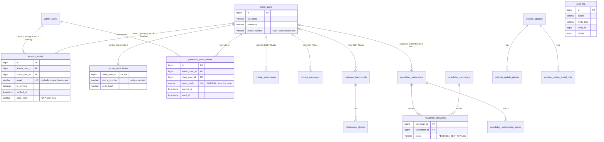

# Database restructuring (Flyway V1 - V9)

PostgreSQL schema, normalised (3NF, BCNF where it applies). Every rule below is
enforced **by the database**, not only by the Java code.

## Entity-relationship diagram

`newsletter_campaign_stats` (view) calculates recipients / sent / failed from
`newsletter_deliveries`. `audit_log` is append-only and is written by triggers.

## What each migration does

| Migration | Purpose |
|---|---|
| **V1** `add_safe_constraints` | Creates the legacy tables if the database is empty (fresh install / CI); trims and lower-cases data; adds constraints on columns that survive the restructure. |
| **V2** `create_account_emails` | One table for every e-mail address of both account types, with global uniqueness (pending changes included), one primary + at most one pending per account, and the verification state next to the address. |
| **V3** `migrate_account_email_handling` | Moves e-mails and OTP state into `account_emails`; drops the old columns. Phone: `client_users.phone_number` holds only a **verified** number (no alternate/pending column, no `phone_verified` flag); a number being verified lives in `phone_verifications`. Stops with a clear message if two accounts already share an address. |
| **V4** `fix_intake_name_handling` | Submitter name / e-mail / phone are copied onto the submission (trigger), the submitted text is immutable, decisions are final, deleting an account keeps its submissions. Removes legacy status `NEW`. |
| **V5** `fix_contact_message_senders` | Sender details stay on the message, message text is immutable, optional account link survives account deletion. |
| **V6** `fix_testimonial_aliases` | Alias, text and consent are immutable; testimonial survives account deletion; "public needs approval + consent", "home page needs public" and "max two on home page" are enforced by the database. |
| **V7** `remove_newsletter_counters` | Removes `recipient_count / success_count / failed_count` from campaigns (calculated from deliveries instead). Guest **and** registered subscribers; append-only subscription history; deliveries can never be deleted by cascade. |
| **V8** `fix_password_reset_references` | Real foreign keys instead of `user_type + user_id`; only a SHA-256 hash of the token is stored; `used_at`; at most one unused token per account. |
| **V9** `add_data_integrity_constraints` | Consistent delete rules (CASCADE for owned rows, SET NULL for history, RESTRICT for deliveries), remaining cross-field checks, query indexes, and the append-only `audit_log` with triggers (password changes, e-mail changes, intake/testimonial decisions, feature switches, newsletter sends, password resets - never any secret). |

## Delete rules

| Relationship | Rule |
|---|---|
| account -> its e-mails, phone verification, reset tokens | `CASCADE` |
| account -> intakes, contact messages, testimonials, newsletter subscription | `SET NULL` (history is kept) |
| subscriber / campaign -> deliveries, subscription events | `RESTRICT` (history is never lost) |
| testimonial / website update -> photos, links | `CASCADE` |

## How to apply

1. Back up the database first: `pg_dump -Fc essential_butterfly > backup.dump`
2. Start the backend. Flyway baselines an existing database and runs V1-V9.
3. If startup says *"Migration checksum mismatch"* or *"Detected applied migration not resolved"*,
   an earlier run recorded the (then empty) V1-V9 files as applied. Run
   `SELECT version, description FROM flyway_schema_history;` - if it lists V1-V9, then:
   `DROP TABLE flyway_schema_history;` and start the backend again (nothing real was applied).

## Tests that need updating after this change

- `NewsletterAndTokenRepositoriesIntegrationTest`, `NewsletterServiceTest`: campaigns no longer
  have `recordResults / recordRetryResults / getRecipientCount / getSuccessCount / getFailedCount`
  (use `recordOutcome(success, failed)`; counts come from `NewsletterDeliveryRepository.countStatuses...`).
- `PasswordResetServiceTest`, `NewsletterAndTokenRepositoriesIntegrationTest`: `PasswordResetToken`
  is built with `PasswordResetToken.forAdmin / forClient(tokenHash, owner, expiresAt)` and looked up
  with `findByTokenHash(sha256(token))`.
- Repository integration tests use `ddl-auto=create-drop`; switch them to Flyway
  (`spring.flyway.enabled=true`, `ddl-auto=validate`) so they run against the real schema.
- Anything that stubs `ClientUserRepository.existsByEmail` for signup must also stub
  `AdminUserRepository.existsByEmail` (signup now checks both account types).
